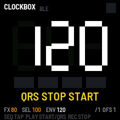
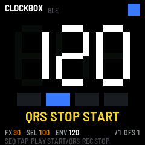
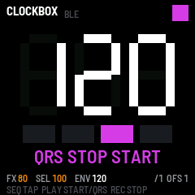

# CLOCKBOX for the M-VAVE FM-1

[ClockBox v3](https://github.com/Andymann/clockbox-v3) (socialmidi.com, firmware 3.55) ported to the M-VAVE FM-1.
It turns the FM-1 into a tight 24 PPQN MIDI master clock with:

- clock over USB MIDI and Bluetooth MIDI
- Quantized Restart (QRS): re-syncs your gear on the next downbeat without stopping the music
- two follow modes: passes through clock from the TRS MIDI in or from USB
- tap tempo
- three presets that jump to a tempo or fade to it
- a sync pulse on the audio output

  

**User manual:** [app/docs/MANUAL.md](app/docs/MANUAL.md)

## Quick reference

| Control | Action |
|---|---|
| SELECT / ALGO | tempo ±1 / ±5 BPM (30–300) |
| SEQ | tap tempo |
| PLAY | Start; while running: quantized restart on the next downbeat |
| REC | Stop |
| FX / SEL / ENV | presets: press = jump, hold 1 s = fade, HOME + press = store |
| HOME + PLAY | mode: QRS STOP START, QRS START, FOLLOW DIN, FOLLOW USB |
| HOME + REC, HOME + SEQ, PLAY + REC (hold, turn SELECT) | QRS offset, sync-pulse divider, LED brightness |
| EDIT | sync out on the audio jack on / off |
| OCT− / OCT+ held | nudge the tempo −7.5 % / +7.5 % |

## Install

You install custom firmware at your own risk. The FM-1 has a mask-ROM recovery mode, and fm1-base's installer can
put M-VAVE's firmware back.

1. Get `clockbox.fwsc`: from the [Releases](https://github.com/andymann/clockbox-v3-mvave-fm1/releases), or build it
   yourself (below).
2. Connect the FM-1 by USB and run:

   ```bash
   python3 base/tools/fm1_install.py clockbox.fwsc
   ```

   (needs `python-rtmidi` and `mido`; `make venv` sets them up in `.venv`.)

## Build

Clone the repository with its submodules (fm1-base in `base/`, and felucca-bsp inside it):

```bash
git clone --recursive https://github.com/andymann/clockbox-v3-mvave-fm1
```

You need Python 3 with Pillow built with raqm. On macOS that means `brew install fribidi`, then `make venv`. The
device build also needs the JieLi toolchain (`make toolchain`) and, on macOS, Docker (the build runs in a
linux/amd64 container). fm1-base's [README](https://github.com/charlesvestal/fm1-base) covers the details.

| Command | What |
|---|---|
| `make host` | builds the host simulator and runs every check in `app/tests/basic.txt`, plus the manual's screenshots. Writes PNGs and WAVs to `app/build/host` |
| `make fw` | builds `app/build/clockbox.fwsc` (development identity `FM-1_13097700`) |
| `make install` | flashes `app/build/clockbox.fwsc` to a connected FM-1 |
| `make web` | builds the browser emulator in `app/build/emu` (needs emcc) |
| `make release V=0.1` | builds `app/build/clockbox-0.1.fwsc` |

Pushing a tag `vX.Y` builds, tests, attests and publishes a release on GitHub
([.github/workflows/release.yml](.github/workflows/release.yml), via the shared
[zvenson/fm1-build](https://github.com/zvenson/fm1-build) builder).

Before the first release, fill in `app/fm1.toml`:

- `id_prefix` is `FM-1_130977`: release v0.1 gets the identity `FM-1_130977000100`.
- `install` and `site`: the release build refuses to run while these are empty.

## Layout

```
app/                 the firmware (fm1-base app)
  app.c, app.h       clock engine, QRS, follow modes, tap tempo, presets, sync pulses, UI
  fm1.toml           build settings, package identity, firmware.json fields
  words.tsv          screen-reader words
  tests/             host-simulator scripts (basic.txt: all checks; screens.txt: manual screenshots)
  docs/MANUAL.md     user manual, docs/img/ its screenshots
  site/landing.md    front page for base/tools/make_site.py
base/                fm1-base (submodule, MPL-2.0), the FM-1 platform and build tools
build.sh             ./build.sh [--host | --web | --release X.Y]
tests/run_tests.sh   the tests the release workflow runs
firmware.json        the firmware's description for firmware hubs (written by the build)
```

## Hardware notes

- SoC: JieLi AC791N (WL82). SPI flash ID 0x856014 or 0xB36014.
- CLOCKBOX stores its settings at flash offset 0xFC000. The panel calibration is at 0xDC000 and Bluetooth pairing at
  0xDE000.
- The FM-1 has no MIDI out jack, so clock goes out over USB and Bluetooth. The ClockBox's CV jacks become pulses on
  the audio output: left = clock, right = reset.

## Licence

MPL-2.0 (see [LICENSE](LICENSE)); credits in [CREDITS.md](CREDITS.md). M-VAVE and FM-1 are trademarks of their
owners. This project is not affiliated with M-VAVE.
